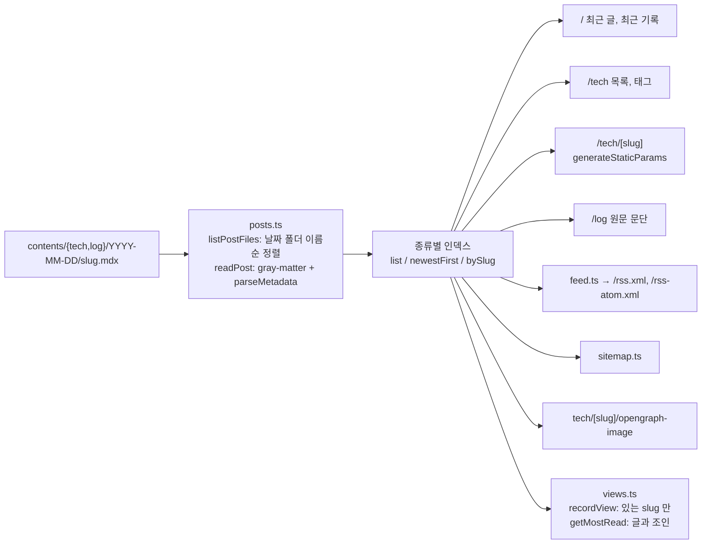
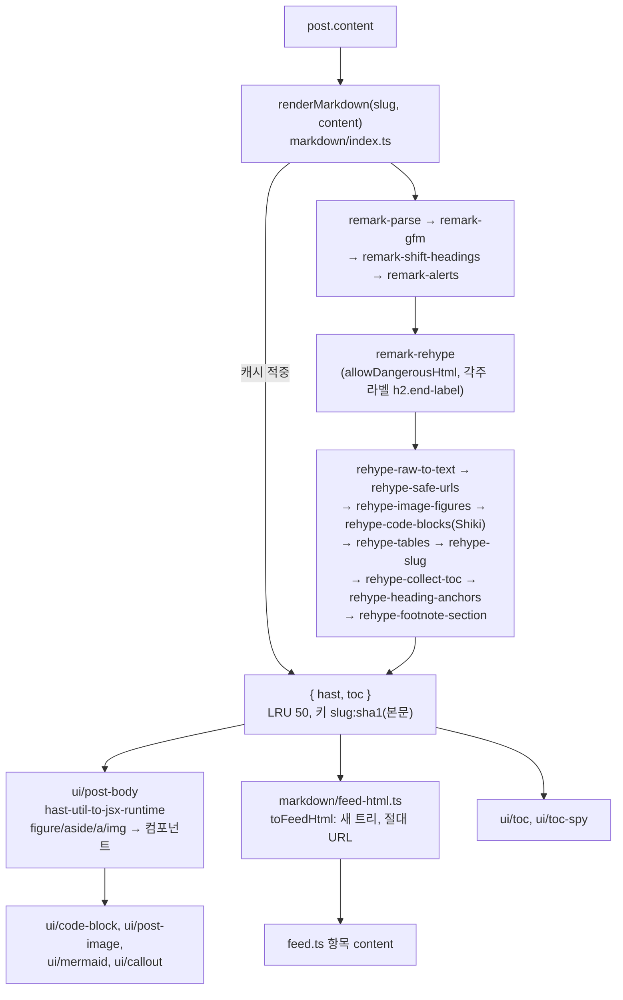

# blan19.xyz 구조 (Architecture)

이 문서는 "무엇이 어디 있고 어떻게 흐르는가"를 적는다. 이유는 [intent.md](intent.md), 디자인 값은 [design.md](design.md), 지켜야 할 규칙은 `CLAUDE.md` 와 `.claude/rules/*.md` 가 원본이다(여기서는 링크만 한다).

## 1. 라우트

렌더 표시는 `npm run verify` 의 next build 출력이다. ○ 정적(빌드 때 prerender), ● generateStaticParams 로 빌드 때 생성, ◐ Partial Prerender(정적 셸 + 요청 때 채우는 `<Suspense>` 구멍).

| 경로 | 파일 | 렌더 | 요청 때 채우는 것(DB) |
|---|---|---|---|
| `/` | `src/app/page.tsx` | ◐ | 많이 읽힌 글(`MostRead`). 최근 글 행에는 조회수가 없다 |
| `/tech` | `src/app/tech/page.tsx` | ◐ | 태그 필터와 목록(`searchParams`), 행 조회수(`RowViews`) |
| `/tech/[slug]` | `src/app/tech/[slug]/page.tsx` | ◐ (모든 글 prerender) | 글 머리 조회수(`ArticleViews`, +1 기록). 목록에 없는 slug 는 `src/proxy.ts` 가 루트 404 로 rewrite(빌드 때 인라인된 slug 목록 기준) |
| `/log` | `src/app/log/page.tsx` | ○ | 없음(마크다운 렌더 없이 원문 문단) |
| `/rss.xml`, `/rss-atom.xml` | `src/app/{rss.xml,rss-atom.xml}/route.ts` | ○ | 없음(`src/lib/feed.ts` 의 `buildFeed`) |
| `/sitemap.xml`, `/robots.txt` | `src/app/sitemap.ts`, `robots.ts` | ○ | 없음 |
| `/opengraph-image`, `/tech/opengraph-image`, `/log/opengraph-image` | `src/app/opengraph-image.tsx`(뒤의 둘은 re-export) | ○ | 없음 |
| `/tech/[slug]/opengraph-image` | `src/app/tech/[slug]/opengraph-image.tsx` | ● | 없음. 없는 slug 는 404 |
| `/icon.svg`, `/favicon.ico` | `src/app/icon.svg`, `favicon.ico` | ○ | 없음 |
| 404, 오류 | `src/app/not-found.tsx`, `error.tsx`(client) | ○ | 없음 |

공통 셸은 `src/app/layout.tsx`(메타데이터 기본값, 테마 초기화 인라인 스크립트, 선택적 GA, 헤더, 푸터)다. smoke(`scripts/smoke.mjs`)가 위 경로 24개의 상태 코드와 content-type 을 요청한다.

## 2. 모듈 지도

### src/lib

"server-only" 는 첫 줄에 `import "server-only"` 가 있다는 뜻이다(클라이언트 번들에 들어가면 빌드가 실패한다).

| 모듈 | 하는 일 | 경계 |
|---|---|---|
| `posts.ts` | `contents/` 를 읽어 종류별 인덱스(`list`, `newestFirst`, `bySlug`)를 만든다. frontmatter 런타임 검증, `---js` 거부, slug 중복이면 throw. `getBlogPosts`, `getPostsNewestFirst`, `getPost`, `getAdjacentPosts`, `getLatestPublishedAt`, `groupByYear`, `getTagCounts`, `getLogParagraphs` | server-only |
| `views.ts` | 조회수 읽기와 쓰기 전부: `recordView`, `getViewMap`, `getMostRead`(내부 `getTopViews`) | server-only, Server Action 아님 |
| `prisma.ts` | Prisma 클라이언트(`@prisma/adapter-pg`, TLS). development 에서만 global 캐시 | server-only |
| `feed.ts` | `buildFeed()`: RSS/Atom 공용 `Feed` 객체 | server-only |
| `og-image.tsx` | `renderOgImage(title, label?)`: 1200×630 카드. 폰트를 모듈 스코프에서 읽음 | server-only |
| `metadata.ts` | `alternates()`, `openGraph()` 헬퍼, `OG_SIZE`, `OG_CONTENT_TYPE` | 공용(서버에서만 씀) |
| `config.ts` | 사이트 정체성과 외부 서비스 설정(`site`, `author`, `comments`, `analytics`) | 공용, 비밀 값 없음 |
| `page-ids.ts` | 글 페이지 고정 DOM id(`PAGE_IDS`) | 공용, import 없음(검사기가 읽음) |
| `format.ts` | 날짜와 조회수 표기 | 공용 |
| `theme.ts` | 테마 API(`setThemePref`, `subscribeResolvedTheme` 등) | 브라우저 전용 함수, `"use client"` 아님 |
| `laptop.ts` | 히어로 노트북의 순수 기하(점 생성, 투영, 자세, 불투명도 칸, `laptopSvg`) | 공용(서버 SVG 와 캔버스) |
| `laptop-canvas.ts` | `createLaptopCanvas(canvas, figure, opts) => dispose`: 홈 히어로 애니메이션 엔진 | 브라우저 전용 |
| `markdown/` | 글 렌더 파이프라인(4장) | `index.ts`, `shiki.ts`, `code/highlight.ts`, `feed-html.ts` 는 server-only. `languages.ts`, `types.ts`, `image-meta.ts`, `figures.ts`, `hast-utils.ts` 는 공용 |

### src/components

- `layouts/header`, `layouts/footer`: 크롬. 푸터 연도는 `process.env.BUILD_YEAR`(빌드한 해).
- `ui/<kebab>/index.tsx`: 기본은 Server Component 다.
- 클라이언트 섬(`"use client"`): `ui/nav-links`, `ui/theme-toggle`, `ui/copy-button`, `ui/code-fold`, `ui/mermaid`, `ui/post-image`, `ui/toc-spy`, `ui/comment`, `ui/hero-canvas`, 그리고 `src/app/error.tsx`.
- DB 를 읽는 서버 컴포넌트: `ui/view-count`(`ArticleViews`, `RowViews`, `ViewsPending`), `ui/most-read`(`MostRead`, `MostReadPending`). 모두 `<Suspense>` 안에서만 쓴다.

### scripts 와 .claude

| 위치 | 하는 일 |
|---|---|
| `scripts/verify.mjs` | 검증 단계 전체(로컬과 CI 공용) |
| `scripts/smoke.mjs` | 기존 `.next` 를 DB 차단 `next start` 로 띄워 라우트 요청 |
| `scripts/validate-content.mjs` + `scripts/content/*.mjs` | 글 검사기(CLI + 규칙 모듈 + 테스트) |
| `scripts/with-blocked-db.mjs` | 임의 명령을 차단 env 로 실행(`--preview` 는 `POSTGRES_URL` 만 비움) |
| `scripts/lib/` | `blocked-db.mjs`(차단 주소 원본), `paths.mjs`(저장소 루트, bin 해석), `import-ts.mjs`(`importTs`: Node 타입 제거로 `.ts` 를 import) |
| `.claude/hooks/` | `guard-bash.mjs`(+ `guard-bash/lex.mjs`, `rules.mjs`), `post-edit-check.mjs`, `session-start.mjs`, `guard-bash.test.mjs` |

## 3. 콘텐츠 → 라우트

- 인덱스는 production 에서 종류별로 프로세스당 한 번 읽고(모듈 `Map`), dev 에서는 요청마다 읽는다(React `cache`).
- 글 객체는 얼어 있고(`Object.freeze`) 요청 사이에 공유된다. 고치지 말고 복사해 쓴다.
- 구조 오류(날짜가 아닌 폴더, 폴더당 `.mdx` 개수, frontmatter, slug 중복)는 파일 경로를 담아 throw 하므로 빌드가 실패한다. 같은 규칙을 검사기가 먼저 잡는다(`.claude/rules/content.md`).

## 4. 마크다운 파이프라인

- 플러그인과 컴포넌트 사이의 데이터 계약은 `markdown/figures.ts`(encode/decode: `figure.code-block`, `figure.img-fig`, `figure.diagram`, `aside.callout`) 하나다. 플러그인이 encode, `ui/post-body` 와 `feed-html.ts` 가 decode 한다.
- 코드 블록: `rehype-code-blocks` 가 글당 한 번 `code/highlight.ts` 의 `loadHighlighter()` 를 기다리고, 블록마다 `highlightCode()` 를 부른다. 메타 해석은 `code/meta.ts`, 줄 앞 gutter 는 `code/transformers.ts`, 언어 모듈은 `shiki.ts` 의 `LANG_LOADERS`(키는 `languages.ts` 의 `CODE_LANGUAGES` 와 tsc 로 맞춘다).
- 실패와 대체: Shiki 초기화가 실패하면 그 글의 코드가 평문 pre 가 되고 그 렌더는 캐시하지 않는다(`file.data.highlightDegraded`). 블록 하나가 실패하면 그 블록만 text 로, 그것도 실패하면 평문으로 그린다.
- 렌더 세부 규칙(헤딩 레벨, URL 규칙, 코드 메타, 콜아웃, 이미지 메타)의 원본은 `.claude/rules/frontend.md` 와 `content.md` 다.

## 5. 조회수 경로

```mermaid
flowchart TD
  subgraph W["쓰기: /tech/[slug] 요청"]
    W1["PostHeader<br/>&lt;Suspense fallback=ViewsPending&gt;"] --> W2["ArticleViews<br/>await connection() (try 밖)"]
    W2 --> W3["recordView(slug)<br/>React cache, connection()<br/>POSTGRES_URL 없거나 없는 글 → null"]
    W3 --> W4["prisma.view.upsert<br/>create 1 / update +1, 올린 값 반환"]
  end
  subgraph RV["읽기: 목록 행 (/tech)"]
    R1["PostRow<br/>&lt;Suspense fallback=null&gt;"] --> R2["RowViews<br/>await connection()"]
    R2 --> R3["getViewMap()<br/>React cache: 요청당 findMany 1번<br/>실패는 여기서 한 번 로그"]
  end
  subgraph MR["읽기: 홈 많이 읽힌 글"]
    M1["&lt;Suspense fallback=MostReadPending&gt;"] --> M2["MostRead<br/>await connection()"]
    M2 --> M3["getMostRead(3)<br/>connection(), POSTGRES_URL 없으면 []"]
    M3 --> M4["getTopViews(3)<br/>'use cache: remote'<br/>cacheLife('hours'), cacheTag('views')"]
    M4 --> M5["findMany orderBy count desc, take 3"]
    M3 --> M6["posts.ts 와 조인<br/>DB 에만 남은 slug 는 버림"]
  end
```

- 각 컴포넌트는 쿼리만 try/catch 하고 catch 첫 줄에서 `unstable_rethrow` 후 `null` 을 렌더한다. 그래서 DB 실패는 그 칸이나 섹션만 지운다.
- `connection()` 이 prerender 를 그 자리에서 멈추므로 빌드는 쿼리하지 않는다. `views.ts` 함수도 각자 `connection()` 을 부른다(호출부가 빠뜨려도 막힌다). `'use cache'` 스코프 안에서는 부를 수 없어 `getMostRead` 에서 부른다.
- `with-blocked-db.mjs --preview` 는 `POSTGRES_URL` 만 비워 세 경로가 모두 DB 를 건너뛰게 한다(조회수 칸과 많이 읽힌 글이 없는 화면).
- 함수 표, 스키마, 변경 절차는 `.claude/rules/database.md`.

## 6. 캐시

| 무엇 | 어디 | 키 | 한도 | 수명 |
|---|---|---|---|---|
| 글 인덱스 | `posts.ts` 모듈 `Map`(production) / React `cache`(dev) | 종류(`tech`, `log`) | 2개 | 프로세스 / 요청 |
| 렌더된 글(HAST, TOC) | `markdown/index.ts` 모듈 `Map`(LRU) | `${slug}:${sha1(본문)}` | 50개 | 프로세스. 실패와 평문 대체 결과는 지움 |
| Shiki 하이라이터 | `markdown/shiki.ts` 모듈 싱글턴 promise | 없음 | 1개 | 프로세스. import 때 시작, 실패하면 다음 호출에서 다시 만듦 |
| OG 폰트 | `og-image.tsx` 모듈 스코프 `readFile` | 없음 | 1개 | 프로세스(카드는 빌드 때만 그림) |
| `recordView` | React `cache` | slug | 요청 | 요청(같은 요청에서 두 번 세지 않음) |
| `getViewMap` | React `cache` | 없음 | 요청 | 요청 |
| `getTopViews` | `'use cache: remote'`(Vercel 원격 캐시, 로컬 `next start` 는 메모리) | 인자 `take` | – | `cacheLife('hours')`, 태그 `views`. 배포마다 새로 채움. 오류는 캐시하지 않음 |
| 정적 셸, 피드, sitemap, OG PNG | 빌드 출력(`.next`) | 경로 | – | 배포 |
| 떠난 페이지 | 클라이언트 `<Activity>`(Cache Components) | 경로 | Next 기본(최대 3개) | 세션. DOM 에 숨겨져 남아 id 가 겹칠 수 있음 |
| Prisma 클라이언트 | `global.prisma` | – | 1개 | development 에서만 |

## 7. 외부 출처

| 출처 | 언제 | 무엇 | 끄는 법 / 제약 |
|---|---|---|---|
| Neon Postgres | 요청 때(서버) | 조회수 | `POSTGRES_URL` 이 비면 건너뜀 |
| `fonts.googleapis.com` 등 | 빌드 때 | `next/font/google` 이 IBM Plex Mono 를 받아 자체 호스팅 | 오프라인 빌드 불가. 런타임 요청 없음 |
| `*.googletagmanager.com`, `*.google-analytics.com` | 브라우저 | GA 스크립트와 수집 | `NEXT_PUBLIC_GOOGLE_ANALYTICS_ID` 를 비우면 넣지 않음 |
| `utteranc.es` | 브라우저 | 댓글 iframe(`utterances.html`), GitHub 로그인 | 댓글 영역이 가까워지면 src 를 붙임. 저장소는 `config.ts` 의 `comments.repo` |
| `github.com/blan19/**`, `github.com/user-attachments/**` → `*.githubusercontent.com` | 서버(이미지 최적화) / 브라우저 | 글 이미지. 문단 맨 앞 이미지는 `/_next/image`, 문단 중간 이미지는 원본 URL 직접 | `next.config.js` `images.remotePatterns`, 쿼리 없음 |

## 8. 보안 헤더

`next.config.js` 의 `headers()` 가 모든 경로에 보낸다.

| 헤더 | 값 요약 |
|---|---|
| `X-Content-Type-Options` | `nosniff` |
| `Referrer-Policy` | `strict-origin-when-cross-origin` |
| `Permissions-Policy` | camera, microphone, geolocation, browsing-topics 끔 |
| `Content-Security-Policy`(강제) | `frame-ancestors 'none'; base-uri 'self'; form-action 'self'; object-src 'none'` |
| `Content-Security-Policy-Report-Only` | `default-src 'self'`, script `'self' 'unsafe-inline'` + GA, connect GA, img `'self' data: blob:` + GitHub + GA, style `'self' 'unsafe-inline'`, font `'self'`, frame `utteranc.es`, worker `'self' blob:`. 보고 엔드포인트 없음 |

`poweredByHeader: false`. 강제 CSP 로 옮기는 절차는 `next.config.js` 머리 주석과 [intent.md](intent.md) 7장.

## 9. 단일 원본 모듈

여러 곳이 같은 값을 써야 해서 한 파일에 모은 것들이다. 스크립트가 읽는 `.ts` 는 `scripts/lib/import-ts.mjs` 의 `importTs`(Node 타입 제거)로 import 하므로 지울 수 있는 TS 문법만 쓰고 import 를 두지 않는다(세부는 `.claude/rules/tooling.md`).

| 모듈 | 담는 것 | src 의 사용처 | scripts 의 사용처 |
|---|---|---|---|
| `src/lib/config.ts` | `site`(이름, 제목, 설명, `url`, `origins`, `host`, `since`), `author`, `comments`, `analytics` | layout, page, sitemap, robots, footer, wordmark, comment, post-body, feed, metadata, og-image, opengraph-image | 없음 |
| `src/lib/page-ids.ts` | `PAGE_IDS`(글 페이지 고정 id) | layout, post-header, post-body, post-references, comment, toc-spy | `scripts/content/body.mjs`(제목 id 와 겹치면 warn) |
| `src/lib/markdown/languages.ts` | `CODE_LANGUAGES`, `LANGUAGE_ALIASES`, `PLAIN_LANGUAGES`, `DIAGRAM_LANGUAGES`, `normalizeLanguage` | shiki, code/highlight, rehype-code-blocks | `scripts/content/context.mjs` |
| `src/lib/markdown/image-meta.ts` | `parseImageMeta`, `DEFAULT_IMAGE_SIZE`, `isUrlCaption`, `captionHost` | rehype-image-figures, figures, feed-html, post-image | `scripts/content/images.mjs` |
| `src/lib/markdown/figures.ts` | figure/aside 의 encode/decode 계약 | rehype-image-figures, rehype-code-blocks, remark-alerts, post-body, feed-html | 없음 |
| `src/lib/markdown/types.ts` | `TocItem`, `RenderedPost`, `CALLOUT_TYPES`, `CALLOUT_LABELS` | remark-alerts, figures, callout, toc, feed-html 등 | 없음(`scripts/content/body.mjs` 는 같은 목록을 따로 둔다) |
| `scripts/lib/blocked-db.mjs` | `BLOCKED_DB_URL`, `blockedEnv()` | – | with-blocked-db, verify, smoke, `.claude/hooks/guard-bash.test.mjs`. ci.yml 은 YAML 이라 값을 따로 적음 |
| `next.config.js` | `images.remotePatterns` | next/image | `scripts/content/context.mjs`(require) |

## 10. 추가 체크리스트

규칙(Cache Components 금지 사항, DB 컴포넌트 패턴)은 `CLAUDE.md` 의 라우트 절차와 rule 파일이 원본이다. 여기에는 고칠 파일만 적는다.

### 라우트

1. `src/app/<route>/page.tsx` 또는 `route.ts`. 공개 페이지면 `metadata` 에 `alternates(path)`, `openGraph(path, …)`(`src/lib/metadata.ts`)를 넣고, `openGraph` 를 정의했으면 그 세그먼트에 `opengraph-image.tsx` 를 둔다(사이트 카드면 re-export).
2. `scripts/smoke.mjs` 의 `checks` 에 경로와 content-type.
3. 공개 페이지면 `src/app/sitemap.ts` 의 `routes`.
4. 요청 때 데이터가 있으면 `<Suspense>` 구멍과 `connection()`(5장 패턴).
5. `npm run verify` 후 빌드 출력의 렌더 표시(○/●/◐)가 의도와 같은지 본다.

### 글 종류(`PostKind`)

1. `src/lib/posts.ts` 의 `PostKind`.
2. `scripts/content/scan.mjs` 의 `CATEGORIES`(종류별 본문 검사가 다르면 그 분기도).
3. 목록/상세 라우트, `src/app/sitemap.ts`, 필요하면 `src/lib/feed.ts`(지금은 tech 만).
4. 조회수를 쓰면 `src/lib/views.ts` 의 `getPost("tech", …)` 가정을 바꾼다(slug 유일성은 검사기가 종류 사이에서도 보장한다).
5. `.claude/rules/content.md`, `/new-post` 스킬.

### 마크다운 블록

1. 문법을 읽는 플러그인 하나를 `src/lib/markdown/` 에 파일 하나로 추가하고 `index.ts` 의 순서에 넣는다(slug, TOC 앞인지 뒤인지 확인).
2. 컴포넌트로 바꿀 블록이면 `figures.ts` 에 encode/decode 를 추가하고 `ui/post-body` 의 `Figure`/`Aside` 에서 decode, `ui/<kebab>` 컴포넌트를 만든다.
3. `src/lib/markdown/feed-html.ts` 에서 리더용 HTML 로 푼다(클래스, data-*, 래퍼는 피드에 남지 않는다).
4. `src/styles/markdown.css` 에 루트 클래스로 스타일(→ [design.md](design.md)).
5. 검사기 `scripts/content/body.mjs` 에 문법 검사와 `validate-content.test.mjs` 에 테스트.
6. `.claude/rules/content.md`(작성 문법)와 `frontend.md`(렌더러).
